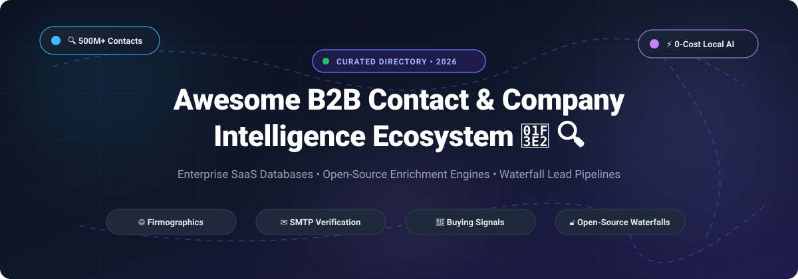

# Awesome-B2b-Contact-Company-Intelligence 🏢 🔍

  

  
  
  
  
  
  

---

## 🌟 Top B2B Contact & Company Intelligence Ecosystem

**Curated List of Commercial Data Platforms & Open-Source Enrichment Engines**  

*Focused on Contact Discovery, Firmographic Enrichment, Email Verification, Intent Signals, Tech Stack Detection & Self-Hosted Data Pipelines*

**Last updated: October 2026** 📅

---

### 📌 Overview & SEO Summary

Welcome to the ultimate curated directory of **B2B contact and company intelligence platforms**, **open-source data enrichment engines**, **lead generation scrapers**, and **firmographic intelligence tools**. Whether you are looking for enterprise-grade commercial solutions (such as *ZoomInfo*, *Apollo.io*, *HubSpot Clearbit*, and *Cognism*), or self-hostable open-source alternatives (like *Google Maps Scraper*, *OpenOutreach*, *Fire Enrich*, *Signal*, *FORGE*, and *enrichment-kit*), this guide covers category leaders, multi-vendor waterfalls, SMTP email verification, and privacy-respecting sales intelligence.

**Search Keywords & Categories**: `b2b-data`, `company-intelligence`, `data-enrichment`, `lead-generation`, `contact-discovery`, `email-finder`, `sales-intelligence`, `firmographics`, `technographics`, `buying-intent`, `waterfall-enrichment`, `apollo-alternative`, `zoominfo-alternative`, `clearbit-alternative`, `clay-alternative`, `open-source-crm`.

**Key Market Highlights & Cost Savings:**
- **OpenOutreach & Google Maps Scraper** deliver zero-cost prospecting with automated AI qualification and local business scraping.
- **FORGE** is the **most complete open-source business data enrichment engine** — enriches business databases using **free data sources and local AI** with **no API keys, no accounts, no credit cards**. Scrapes websites, imports government records (FCC ULS, NPI Registry, SAM.gov), verifies emails via SMTP, and optionally generates AI summaries with local Ollama models (~16K records/hr with 4 workers).
- **enrichment-kit** is the **open-source Clay.com alternative** — **multi-vendor enrichment waterfalls** that order providers by **effective cost (`price / hit_rate`)** and **short-circuit on success**, paying **~$0.004 per verified contact** vs **~$0.12 for Clay** (~$60 vs $300 for 10k leads).
- **Signal** is the **open-source AI sales intelligence platform** — tracks buying signals (hiring changes, funding news, product launches), enriches companies/contacts, drafts outreach, and executes multi-step email sequences.
- **Batuda** is the **open-source CRM with a built-in research agent** — server-side agent loop with a mandatory citation ledger and 90+ MCP tools.
- **opengtm** is the **MIT-licensed GTM engine** — AI-powered lead discovery, 6-dimension ICP scoring, AEO health checks, and 4-touch outreach sequences with Gemini free tier.
- **Commercial SaaS vs Open Source**: Commercial tools (ZoomInfo, Apollo.io, Clearbit) charge **$10,000–$50,000/year** for data largely assembled from public registries and web footprints—open-source engines offer self-hosted, sovereign alternatives with zero subscription markup.

---

## 📑 Table of Contents

- [🏢 SaaS & Commercial Platforms](#-saas--commercial-platforms)
- [🔓 Open-Source GitHub Projects](#-open-source-github-projects)
- [🛠️ How to Contribute](#%EF%B8%8F-how-to-contribute)
- [🤝 Support & Sponsorship](#-support--sponsorship)
- [❓ Frequently Asked Questions (FAQ)](#-frequently-asked-questions-faq)
- [📊 Star History](#-star-history)
- [⚠️ Disclaimer](#%EF%B8%8F-disclaimer)

---

## 🏢 SaaS / Commercial Platforms

> 📊 **Sector Market Size & Structure**: The global B2B sales intelligence and contact data market is estimated at **$4.5B–$5.4B in 2026** (projected to reach **$6.7B–$9.2B+ by 2030** at an 11–14% CAGR). The sector is **moderately to highly fragmented** rather than winner-take-all—no single vendor commands more than ~15% market share, with intense competition among legacy enterprise giants (ZoomInfo, Cognism), modern self-serve prospecting platforms (Apollo.io, Lusha), specialized enrichment APIs, and privacy-first waterfall/open-source solutions driven by industry-wide contact accuracy challenges.

| SaaS / Commercial Platform | Company / Owner | Size (Revenue / Valuation) | Standard Starting Price | Free Tier / Free Trial Limits | Description |
| :--- | :--- | :--- | :--- | :--- | :--- |
| **[Clearbit](https://clearbit.com/)** 🔵 | HubSpot (Acquired) | ~$30B Valuation (HubSpot Market Cap) / ~$3.7B Revenue | **$75/month** (HubSpot Breeze Intelligence Starter add-on) | **No free tier**; standalone free plan discontinued April 30, 2025 (CRM free tools only) | **Enrichment API & Breeze Intelligence** — Company and person enrichment, visitor reveal, and native CRM form autofill. |
| **[ZoomInfo](https://www.zoominfo.com/)** 🎯 | ZoomInfo Technologies | ~$4B Market Cap / ~$1.2B Annual Revenue | **$14,995/year** (SalesOS Professional tier base contract) | **7-day free trial** with access via sales demo; free GTM.AI CLI search lookup | **Enterprise B2B contact database** — 100M+ companies, 500M+ contacts, buying intent signals, and organizational charts. |
| **[Apollo.io](https://www.apollo.io/)** 🚀 | Apollo.io | ~$1.6B Valuation / ~$200M Annual Revenue | **$49/user/month** (Basic plan, billed annually) | **Free forever plan**: 10 export credits/month, 2 sequence steps, basic filters | **All-in-one prospecting and sales engagement** — 275M+ contacts, 73M+ companies, built-in sequences, dialer, and Chrome extension. |
| **[Lusha](https://www.lusha.com/)** 📞 | Lusha | ~$1.5B Valuation / ~$64M Annual Revenue | **$37.45/user/month** (Starter plan, billed annually) | **Free forever plan**: 40 credits/month (1 credit per email, 5 credits per phone number) | **Direct dial and email finder** — Browser extension prospecting across LinkedIn and Salesforce records. |
| **[Cognism](https://www.cognism.com/)** 🌍 | Cognism | ~$450M Valuation / ~$71M Annual Revenue | **$15,000/year** (Grow plan base annual contract) | **No free tier**; custom live trial demo provided upon sales qualification | **International phone-verified B2B data** — Diamond Data phone verification and GDPR/CCPA-compliant European contact coverage. |
| **[Crunchbase Enterprise](https://www.crunchbase.com/)** 📈 | Crunchbase | ~$150M+ Valuation / ~$50M Annual Revenue | **$49/user/month** (Crunchbase Pro, billed annually) | **Free forever tier**: basic company search and profile viewing; paid features require trial/subscription | **Company & investment intelligence** — Private venture funding rounds, acquisition intelligence, executive movements, and investor portfolios. |
| **[LeadIQ](https://leadiq.com/)** ⚡ | LeadIQ | ~$100M–$250M Valuation / ~$35M Annual Revenue | **$15/user/month** (Essential plan, billed annually) | **Free forever plan**: 50 credits/month for 1 user seat | **Sales prospecting & LinkedIn capture** — Automated lead enrichment, contact capture directly into Salesforce/HubSpot. |
| **[UpLead](https://www.uplead.com/)** 📊 | UpLead | Private / ~$15M Annual Revenue | **$74/month** (Essentials plan, billed annually) | **7-day free trial**: 5 download/verification credits included | **Guaranteed 95% accuracy B2B contacts** — Real-time email verification, firmographic filters, and technographic data. |
| **[Kaspr](https://www.kaspr.io/)** 🇪🇺 | Kaspr (Cognism Group) | Acquired by Cognism / ~$4.5M Annual Revenue | **€45/user/month** (Starter plan, billed annually) | **Free forever plan**: 15 B2B email credits, 5 phone credits, 5 direct email credits/month | **European contact prospecting tool** — LinkedIn Chrome extension for finding verified mobile numbers and corporate emails. |

---

## 🔓 Open-Source GitHub Projects

*Sorted by GitHub_Stars_Count (Descending)* 🌟

- **[Google Maps Scraper](https://github.com/omkarcloud/google-maps-scraper)**   
  **Open-source Google Maps business scraper & lead extractor**, open-source. **Extracts local business intelligence, emails, phones, social links, and website details** without recurring API fees. Supports high-volume automated lead scraping with zero code, CSV/Excel export, and automated proxy rotation. 🗺️

- **[OpenOutreach](https://github.com/eracle/OpenOutreach)**   
  **Self-hosted AI agent for autonomous B2B lead generation & outreach**, MIT licensed. **Autonomous prospect discovery, ICP evaluation, and cold email outreach directly from your own mailbox**. Avoids third-party platform scraping restrictions by orchestrating local LLMs to identify, score, and qualify high-intent accounts. 🤖

- **[Grab](https://github.com/lorien/grab)**   
  **Python web scraping and business data extraction framework**, MIT licensed. High-performance, mature crawling framework designed for large-scale company directory scraping, network spidering, and automated lead dataset compilation. 🕷️

- **[MailAccess](https://github.com/KatrielMoses/MailAccess)**   
  **Privacy-respecting OSINT email intelligence & identity discovery tool**, GPL-3.0 licensed. Clusters email identities, checks deliverability, detects platform presences, and verifies domain validity without third-party API keys. 🔍

- **[Fire Enrich](https://github.com/firecrawl/fire-enrich)**   
  **AI-powered data enrichment tool that transforms emails into rich datasets**, open-source. **Transforms emails into company profiles, funding data, tech stacks, and more using Firecrawl and multi-agent AI** . **Five specialized agents**: **Discovery Agent** (company name, website, business type), **Company Profile Agent** (industry, headquarters, year founded), **Financial Intel Agent** (funding stage, total raised, investors), **Tech Stack Agent** (programming languages, frameworks, infrastructure), **General Purpose Agent** (custom fields like CEO, competitors). **Sequential execution with shared context** — each agent adds context that makes subsequent searches more accurate. **Type-safe Zod schemas** for easy extensibility. **Field routing system** automatically categorizes user requests . 🔥

- **[Signal](https://github.com/jay-sahnan/signal)**   
  **Open-source AI sales intelligence and outreach automation**, open-source. **The open alternative to Clay, Apollo, and Outreach — run it on your own keys** . **Watches the web for buying signals** (hiring changes, funding news, product launches, review shifts), **enriches the companies and contacts behind them**, **drafts personalized outreach**, and **runs multi-step email sequences** — all from a single chat-first workspace. **Signals engine**: authorable "recipes" that watch companies and surface buying triggers. **Contact enrichment**: pulls LinkedIn, GitHub, and company pages into a single profile. **Outreach sequences**: multi-step emails sent from your own Gmail with reply/bounce tracking. **Browser automation**: Browserbase + Stagehand for the long tail of sites without APIs. **Tech stack**: Next.js 16, React 19, TypeScript, Supabase (Postgres + Auth + RLS), Anthropic Claude, Tailwind CSS 4, shadcn/ui. **Own your data** — Postgres + RLS on your Supabase; bring your own LLM keys . 🎯

- **[FORGE](https://github.com/Nuclear-Marmalade/dataforge)**   
  **Free open-source business data enrichment engine**, open-source. **The open-source alternative to Apollo, ZoomInfo, and Clearbit** — **enriches business databases using free data sources and local AI** . **No API keys, no accounts, no credit cards. Runs on your machine**. **Features**: **email extraction (6 layers)** — mailto links, regex, Cloudflare decode, JSON-LD, obfuscation decode, contact page crawl. **SMTP verification** — generates candidates (info@, contact@, admin@), verifies via RCPT TO without sending mail. **Tech detection (30+)** — WordPress, Shopify, React, Next.js, Stripe, Intercom, Google Analytics, Tailwind. **Government data importers** — FCC ULS (~3M records), NPI Registry (~7M records, free API), SAM.gov (~900K entities, free API key). **Local AI enrichment** via Ollama — business summaries, industry classification, health scores, pain points. No API costs. **Two parallel tracks**: web scraping (~16K records/hr with 4 workers) and AI track (~7-20K/day). **COALESCE writes** (only update NULL fields) and checkpoint after every batch . 🚀

- **[opengtm](https://github.com/buildingopen/opengtm)**   
  **MIT-licensed open-source GTM engine**, MIT licensed. **AI-powered lead discovery, 6-dimension ICP scoring, AEO health checks, 4-touch outreach sequences, and Claude Code integration** . **Runs locally with Gemini free tier (1,500 requests/day)** — sufficient for most small teams. **Monthly cost: Free vs $807/month if you replaced opengtm with Clay, Apollo, Instantly, Semrush, Clearbit, and AEO SaaS tools**. **Use cases**: startup founders doing 0-to-1 outbound, growth agencies running discovery at scale, SEO consultants running AEO health checks. **Python API**: `discover()`, `research()`, `qualify_batch()`, `generate_messages()`, `run_health_check()`, `generate_article()`, `research_keywords()` . 📊

- **[Linkedin-Leads-Generation](https://github.com/ahmedmujtaba1/Linkedin-Leads-Generation)**   
  **Automated B2B LinkedIn lead generation & contact scraper**, MIT licensed. Python and Selenium-based automation pipeline to search targeted profiles, extract company roles, scrape verified contact information, and output structured CSV files for sales prospecting. 💼

- **[enrichment-kit](https://github.com/masteranime/enrichment-kit)**   
  **Open-source Clay.com alternative**, open-source. **Multi-vendor enrichment waterfalls — bring your own API keys, pay ~85% less per lead** . **The waterfall pattern**: orders providers by **effective cost (`price / hit_rate`)** and **short-circuits on success** — Hunter ($0.004, 55% hit rate) → Apollo ($0.01, 70%) → SerpAPI + LLM ($0.02, 80%) → Proxycurl ($0.03, 85%). **For a 10k-lead list, typical cost lands near $60 instead of $300**. **5 providers out of the box** — Hunter, Apollo, Anymailfinder, SerpAPI + LLM, Proxycurl. **Built-in cache** — file or memory, 30-day TTL by default, enrichments are **~40% cheaper after week 1**. **Semantic validation gate** — catches role emails, domain mismatches, malformed LinkedIn URLs before they corrupt your DB. **CSV batch mode** — enrich 10k rows with one command. **CLI + SDK** — use it as a tool or embed it. **TypeScript-native** — full types, zero `any` . 🛠️

- **[zero-gtm](https://github.com/man0l/zero-gtm)**   
  **Zero-cost GTM lead scraper and enrichment pipeline**, open-source. Scrapes business data from Google Maps, finds corporate emails, enriches profiles with AI, and automates cold outreach preparation with zero SaaS subscription fees. 📈

- **[leads-db](https://github.com/IsaacBell/leads-db)**   
  **AI-powered B2B lead generation system**, MIT licensed. **Daily ingestions of company data and Newly Registered Domains (NRDs)**, identifies candidate leads, and presents best results to user . **REST API** for lead data retrieval. **Next.js frontend + Flask backend + Cassandra database**. **Automatic NRD ingestion, company data enrichment using Abstract API, and subscriber management using Notion API**. **GitHub Actions workflow for daily data updates**. 🤖

- **[OpenCRM](https://github.com/clawnify/OpenCRM)**   
  **Open-source HubSpot alternative**, MIT licensed. **A lightweight CRM for SaaS to manage contacts, companies, and deals** . **Contacts belong to companies. A deal has its own company and its own contact, both optional**. **Custom attributes are real columns**, registered in `custom_field_defs`. **Relations** are two defs, one per side, pointing at each other (`inverse_def_id`). **List endpoints take `filters`**: a JSON list, ANDed, of rules `{field, op, value}` and groups `{logic: "and"|"or", rules: [...]}`. 🏢

- **[awesome-b2b-leads](https://github.com/Lead-Orchestra/awesome-b2b-leads)**   
  **Production-ready B2B scraping, enrichment, and n8n lead workflows**, CC0-1.0 licensed. Curated open-source tools, API recipes, scraping frameworks, proxies, and automated n8n waterfall workflows for business prospecting. 📚

- **[website-email-contact-scraper](https://github.com/omkarcloud/website-email-contact-scraper)**   
  **Fast contact and email extractor for domains**, open-source. Crawls target websites and extracts email addresses, telephone numbers, social links, and tech stack signatures into structured JSON format. ✉️

- **[company-data-enrichment](https://github.com/brightdata/company-data-enrichment)**   
  **Company Data Enrichment Tool**, open-source. **Instantly enrich company lists with actionable business data using Bright Data Web Scraper API, Google Gemini AI, and Streamlit** . **Collects 13+ data points per company** — CEO, Founders, Executives, LinkedIn URL, Services, Contact Email, Headquarters, Founded, Funding, Investors, Trustpilot Rating, News, Products, Open Roles. 🏢

- **[Batuda](https://github.com/guillempuche/batuda)**   
  **Open-source CRM with a built-in research agent**, MIT licensed. **Find people, email them, follow up, remember the trail. Your providers, your budget. MCP-ready** . **Research as the core capability**: server-side agent loop with a **mandatory citation ledger**, a **guard chain over extracted fields**, **gap rounds** that keep searching for fields that came back empty, and **live SSE progress**. Five typed schemas including CompanyEnrichmentV1, CompetitorScanV1, and ContactDiscoveryV1. 🏛️

- **[verdict](https://github.com/omm9846/verdict)**   
  **Open-source Apollo and Hunter.io alternative**, MIT licensed. Lightweight cold-outreach and contact discovery engine with automated email finder, SMTP mailbox verification, and deliverability safeguarding. 📬

- **[ai-ark-mcp](https://github.com/dropoutsanta/ai-ark-mcp)**   
  **MCP server for AI Ark API**, open-source. **Search 400M+ people, 69M+ companies, find verified emails, phone numbers, and analyze personalities** . Works with Cursor, Claude, Windsurf, and any Model Context Protocol client with real-time BounceBan verification. 📡

- **[B2B-Lead-Intelligence-Platform](https://github.com/Arnav-Tyagii/B2B-Lead-Intelligence-Platform)**   
  **Account-based GTM intelligence and enrichment platform**, MIT licensed. Python and AI-powered account scoring system that enriches B2B company accounts with technographics and buying intent signals. 🐍

- **[company-gtm-enricher](https://github.com/lucifinil/company-gtm-enricher)**   
  **Local CSV company enrichment tool for GTM data**, open-source. **Upload a CSV with company names, enrich each row with public business data, and download a refreshed CSV** . Appends HQ location, revenue, funding, and confidence score with Streamlit UI. 📁

- **[CObtainFlow](https://github.com/jlingjun/JJCustumorObtain)**   
  **AI-powered B2B enterprise contact discovery tool**, open-source. Just describe what kind of supplier you're looking for, and CObtainFlow automatically completes multi-round search, social/directory verification, and CRM report generation. 🌏

---

## 🛠️ How to Contribute

Contributions are welcome! Follow these steps to submit new B2B intelligence platforms or open-source enrichment software:

1. 🍴 **Fork** the repository.

2. 📝 **Add/edit** entries in `README.md` maintaining table/list structure and formatting.

3. 🔗 Include project title, official website/GitHub link, exact Stars_Count, license, and brief description.

4. 🚀 Submit a **Pull Request** with a descriptive summary of your changes.

---

## 🤝 Support & Sponsorship

A heartfelt **thank you** for checking out and supporting this directory! 💖 If you find this curated collection of B2B contact and company intelligence platforms and open-source enrichment software helpful, please consider supporting the project:

- ⭐ **Star** this repository on GitHub to increase visibility and help others discover these tools!
- 🔀 **Fork & Share** with fellow sales operations leaders, growth engineers, demand generation teams, and open-source advocates.
- ☕ **Buy Me a Coffee**: If you'd like to back ongoing open-source maintenance and research, support the project via the [GitHub Sponsor Dashboard](https://github.com/sponsors/ishandutta2007).

---

## ❓ Frequently Asked Questions (FAQ)

### What is B2B Contact & Company Intelligence?
B2B contact and company intelligence refers to datasets, APIs, and automated software platforms that collect, verify, and deliver business information—including corporate email addresses, direct dial phone numbers, firmographic profiles (revenue, headcount, industry), technographics (tools and tech stack), and intent signals (hiring trends, funding rounds).

### How do open-source enrichment tools compare with commercial SaaS like ZoomInfo or Apollo?
Commercial platforms charge between **$50/month to $50,000+/year** with restrictive export credit systems. Open-source alternatives (such as [FORGE](https://github.com/Nuclear-Marmalade/dataforge), [Signal](https://github.com/jay-sahnan/signal), and [enrichment-kit](https://github.com/masteranime/enrichment-kit)) allow teams to self-host their data pipelines, scrape authoritative public business registries, run local Ollama/Claude/Gemini AI enrichment, and execute multi-vendor waterfalls at a fraction of the cost (~$0.004 per verified contact).

### What is Waterfall Enrichment?
Waterfall enrichment is an optimization strategy where lead queries flow through multiple data providers ordered by cost efficiency (`price / hit rate`). If the lowest-cost provider finds and verifies the lead, the process halts, preventing costly queries to premium enterprise databases.

---

##  Star History

---

## ⚠️ Disclaimer

- This is a **community-curated** list — not exhaustive and not an endorsement. ℹ️
- **Apollo, ZoomInfo, and Clearbit charge $10K–$50K/year** for data that is **largely scraped from public sources** — **FORGE does the same thing for free** . **enrichment-kit pays ~$0.004 per verified contact** vs **~$0.12 for Clay** by using multi-vendor waterfalls .
- **Signal is designed for single-tenant self-hosting** — **one Supabase project per team**. **Upgrading from pre-Clerk versions is destructive and not reversible** — it **wipes all user-owned data** because old Supabase user UUIDs don't map to Clerk IDs .
- **Open-source enrichment tools are not turnkey** — **FORGE requires PostgreSQL and Python 3.x** . **Signal requires Node 20+, Docker, Supabase CLI, and an Anthropic API key** . **Batuda requires Node 24, pnpm 10, Docker, and Postgres** . **Always validate email verification accuracy, data freshness, and compliance (GDPR, CCPA) with a proof-of-concept** before production deployment. 🔍

---

  <b>Made with ❤️ for sales operations leaders, demand generation teams, and open-source B2B intelligence advocates.</b>

